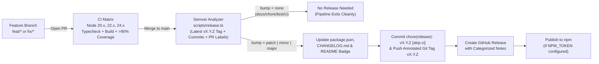

# Contributing & Release Workflow (`foto_mcp`)

All development on `foto_mcp` follows a strict **branch-based Pull Request workflow** paired with an **automated Semantic Versioning (SemVer) release pipeline** powered by GitHub Actions.

---

## 1. Branch-Based Development Flow

Never commit feature or fix work directly to `main`. All changes must be developed on dedicated branches and merged via Pull Request:

1. **Create a Dedicated Branch from `main`:**
   - `feat/<short-name>` — New MCP tools, resources, prompts, or capabilities
   - `fix/<short-name>` — Bug fixes, error handling, or edge-case patches
   - `perf/<short-name>` — Image pipeline or query performance optimizations
   - `docs/<short-name>` — Documentation or roadmap updates
   - `chore/<short-name>` / `ci/<short-name>` — Build, dependency, or CI updates

   ```bash
   git checkout main
   git pull origin main
   git checkout -b feat/my-new-capability
   ```

2. **Implement & Add Unit Tests:**
   - Add unit tests under `test/unit/` covering both happy paths and failure branches.
   - Maintain **>90% code coverage** across lines, statements, and functions (enforced by `c8` via `npm test`).

3. **Run Local Verification:**
   ```bash
   npm run typecheck
   npm run build
   npm test
   npm run release:check
   ```

4. **Open a Pull Request to `main`:**
   - Pushing your branch automatically runs the **CI workflow** (`.github/workflows/ci.yml`) across Node.js `20.x`, `22.x`, and `24.x`.
   - Optionally attach a semver label (`semver:major`, `semver:minor`, `semver:patch`, or `semver:skip`) to explicitly control the release bump when merged.

---

## 2. Automated Semantic Release Pipeline (`.github/workflows/release.yml`)

Whenever a Pull Request is merged (or commits are pushed) to `main`, the **Release & Publish** workflow runs automatically:



### How the Version Bump & Publish Decision Works

The release analyzer ([`src/release/semver.ts`](src/release/semver.ts) & [`scripts/release.ts`](scripts/release.ts)) inspects all commits since the latest `vX.Y.Z` Git tag on `main` along with any labels on the merged PR:

| Signal (Commit Prefix / Marker / PR Label) | Bump Type | Publish Triggered? | Example Next Version (from `3.0.0`) |
| :--- | :---: | :---: | :---: |
| `feat!: ...`, `BREAKING CHANGE:`, `[semver:major]`, or label `semver:major` | **`major`** | **Yes** | `4.0.0` (`v4.0.0`) |
| `feat: ...`, `feat(scope): ...`, `[semver:minor]`, or label `semver:minor` | **`minor`** | **Yes** | `3.1.0` (`v3.1.0`) |
| `fix: ...`, `perf: ...`, `refactor: ...`, `security: ...`, `[semver:patch]`, or label `semver:patch` | **`patch`** | **Yes** | `3.0.1` (`v3.0.1`) |
| `docs: ...`, `chore: ...`, `ci: ...`, `test: ...`, `style: ...`, `[skip release]`, or label `semver:skip` | **`none`** | **No** | Remains `3.0.0` |

### Manual Release Dispatch

Maintainers can also trigger a release manually from the GitHub Actions **Release & Publish** tab using `workflow_dispatch` with an optional `force_bump` (`patch`, `minor`, `major`, or `none`) input.
