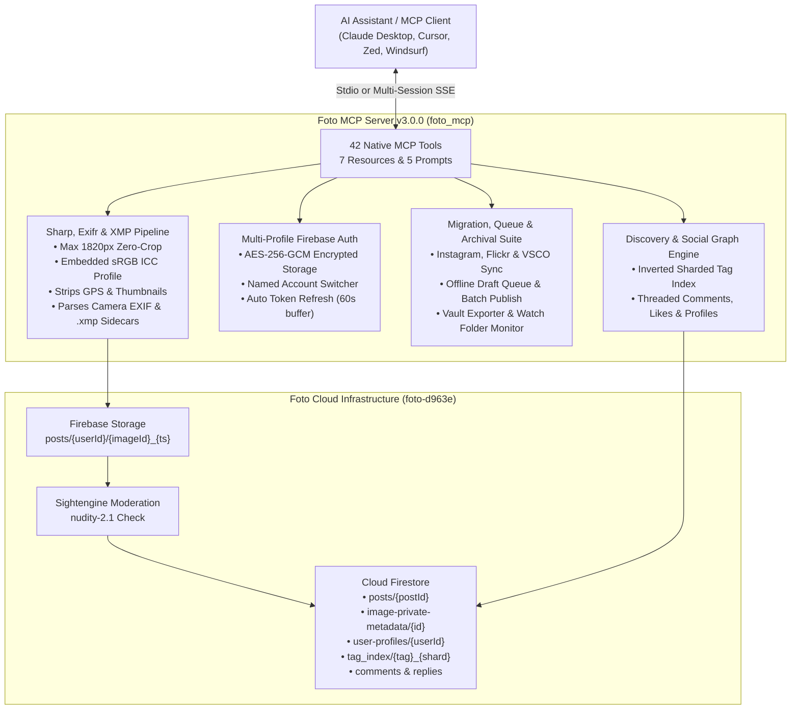

# Foto MCP Server (`foto_mcp`)

[](package.json)
[](LICENSE)
[]()
[]()
[](https://modelcontextprotocol.io)

An official Model Context Protocol (MCP) server for [Foto](https://fotoapp.co/) (`fotoapp.co` / `the.fotoapp.co`), the photography-first social platform.

This MCP server equips AI assistants (Claude Desktop, Cursor, Zed, Windsurf, and custom agent runtimes) to seamlessly inspect local photos and `.xmp` sidecars, extract camera EXIF metadata, select from Foto's official curated taxonomy, publish single frames, multi-image series, and portfolios, manage multi-account profiles and offline draft queues, watch local studio edit folders, migrate archives from Instagram, Flickr, and VSCO directly to your chronological Foto feed, discover photographers across Foto's 303 curated tags, and backup complete vaults.

---

## Architecture Overview



---

## Core Features & Platform Philosophy

* **Zero-Crop Resolution Normalization & Embedded sRGB ICC:** Automatically scales high-resolution camera exports to Foto's 1820px longest-edge standard (JPEG quality 80) with embedded sRGB IEC61966-2.1 ICC profiles while preserving exact original aspect ratios (3:2, 4:3, 1:1, 6:7, 65:24 panoramic, or 16:9).
* **Privacy by Design (GPS Scrubbing):** Automatically strips embedded GPS coordinates and thumbnail IFDs from binary files before upload to prevent wildlife and location tracking.
* **Adobe Lightroom / Capture One `.xmp` Sidecar Integration:** Automatically discovers and parses `.xmp` sidecar files alongside images for star ratings (`xmp:Rating`), color labels (`xmp:Label`), titles, captions, hierarchical keywords, and film stocks.
* **Technical EXIF Preservation:** Parses camera body, lens model, ISO, aperture ($f$-number), shutter speed, and focal length into Foto's `image-private-metadata` system so technical details are preserved for photography enthusiasts.
* **Curated 303 Tag Taxonomy:** Strictly enforces Foto's platform rule of **1 to 3 tags** selected exclusively from the official whitelist of **303 curated photographic tags**. Completely eliminates hashtag spam.
* **Photographer & Content Discovery:** Query Foto's inverted sharded index (`tag_index`) to find recent posts and discover active photographers publishing under any curated genre (such as `Fine Art Nude`, `Boudoir`, `Street`, `Landscape`, or `Analog`).
* **Full Portfolio & Social Graph Lifecycle:** Create, update, list, and delete multi-image Portfolios; read and write threaded comment replies; inspect post likers; update your user profile; and submit community safety reports.
* **Universal Archive Migration (`Instagram`, `Flickr`, `VSCO`):** Migrate photography exports with automatic hashtag scrubbing, VSCO film preset mapping (`A6`, `M5`, `B1`, `HP5`, `Portra`), GPS stripping, and deduplication.
* **Multi-Account Switcher & Offline Draft Queue:** Switch between named Foto accounts (`default`, `street`, `studio`) encrypted at rest with AES-256-GCM, and stage validated posts into a persistent local draft queue for batch publishing.

---

## Quick Start via `npx` (No Installation Required)

You can run `foto_mcp` directly without cloning or building locally:

```bash
npx -y github:thesven/foto_mcp#main
```

---

## Client Configuration

### Claude Desktop
Add this to your Claude Desktop configuration file:
* **macOS:** `~/Library/Application Support/Claude/claude_desktop_config.json`
* **Windows:** `%APPDATA%\Claude\claude_desktop_config.json`
* **Linux:** `~/.config/Claude/claude_desktop_config.json`

```json
{
  "mcpServers": {
    "foto": {
      "command": "npx",
      "args": ["-y", "github:thesven/foto_mcp#main"],
      "env": {
        "FOTO_EMAIL": "your_email@example.com",
        "FOTO_PASSWORD": "your_password"
      }
    }
  }
}
```

### Cursor
Add to `.cursor/mcp.json` or your Global Cursor MCP settings:
```json
{
  "mcpServers": {
    "foto": {
      "command": "npx",
      "args": ["-y", "github:thesven/foto_mcp#main"]
    }
  }
}
```

### Zed Editor
Add to `~/.config/zed/settings.json`:
```json
{
  "experimental.model_context_protocol": {
    "servers": {
      "foto": {
        "command": "npx",
        "args": ["-y", "github:thesven/foto_mcp#main"]
      }
    }
  }
}
```

### Windsurf / Codeium
Add to `~/.codeium/windsurf/mcp_config.json`:
```json
{
  "mcpServers": {
    "foto": {
      "command": "npx",
      "args": ["-y", "github:thesven/foto_mcp#main"]
    }
  }
}
```

### SSE / HTTP Remote Service Mode
In addition to standard Stdio JSON-RPC, `foto_mcp` can run as a persistent multi-session Server-Sent Events (SSE) remote server:

```bash
# Start SSE server on default port 3000
npx -y github:thesven/foto_mcp#main --transport sse --port 3000

# Or via environment variables
export MCP_TRANSPORT=sse
export MCP_PORT=8080
npx -y github:thesven/foto_mcp#main
```

Clients can connect via SSE endpoint: `http://localhost:3000/sse` (and POST messages to `/messages?sessionId=...`).

---

## Authentication & Credentials Security

Foto MCP supports multi-profile authentication with AES-256-GCM encryption at rest:

### Option 1: In-Chat via `foto_login` (Recommended)
Prompt your AI assistant in chat:
> *"Log in to my Foto account with email `you@example.com` and password `your_password`."*

The `foto_login` tool:
1. Connects directly to Google Identity Toolkit REST endpoints.
2. Encrypts and caches session tokens locally in `~/.config/foto-mcp/profiles.json` with user-only permissions (`0600`).
3. Supports multiple named profiles (`profileName`) and instant switching via `foto_switch_profile`.
4. Automatically refreshes expired tokens in the background before subsequent tool calls.

### Option 2: Environment Variables
For automated runtimes, provide credentials in your environment:
```bash
export FOTO_EMAIL="you@example.com"
export FOTO_PASSWORD="your_password"
```

---

## Complete MCP Tool Suite (42 Tools)

| Tool | Purpose | Key Arguments |
| :--- | :--- | :--- |
| `foto_auth_status` | Inspects active session, profile name, token validity, and remaining minutes. | *None* |
| `foto_login` | In-chat authentication via email and password; saves to named encrypted profile. | `email`, `password`, `profileName?` |
| `foto_logout` | Clears cached session tokens for active or specified profile. | `profileName?` |
| `foto_list_profiles` | Lists all saved Foto account profiles and shows which account is active. | *None* |
| `foto_switch_profile` | Switches the active Foto account profile on the fly. | `profileName` |
| `foto_inspect_image` | Inspects local image & `.xmp` sidecar: returns dimensions, color space, GPS status, camera EXIF, and sRGB base64 preview thumbnail. | `filePath`, `includePreview?` |
| `foto_parse_xmp` | Parses an Adobe Lightroom, Capture One, or Darktable `.xmp` sidecar file for ratings, color labels, titles, keywords, and film recipes. | `filePath` |
| `foto_suggest_tags` | Suggests 1 to 3 valid tags from the 303 curated tags list based on caption, gear notes, film stock, or Fuji film simulations. | `caption?`, `cameraInfo?`, `keywords?` |
| `foto_search_tags` | Searches the 303 curated tags whitelist by prefix or keyword. | `query`, `limit?` |
| `foto_browse_tag` | Browse recent public posts under any of Foto's 303 curated tags with shard and pagination support. | `tag`, `limit?`, `shard?` |
| `foto_find_photographers_by_tag` | Finds active photographers publishing under a curated tag (e.g. `Fine Art Nude`, `Boudoir`, `Portrait`, `Street`). | `tag`, `limit?` |
| `foto_follow_user` | Follows one or more photographers on Foto by user ID(s) via atomic Firestore `:commit` transforms. | `userId?`, `userIds?` |
| `foto_unfollow_user` | Unfollows one or more photographers on Foto by user ID(s) via atomic Firestore `:commit` transforms. | `userId?`, `userIds?` |
| `foto_draft_post` | Validates a post draft and returns a multimodal `ImageContent` preview alongside EXIF and tag checks. | `filePath`, `caption`, `tags`, `includePreview?` |
| `foto_publish_post` | Normalizes image (1820px, embedded sRGB ICC), scrubs GPS, passes Sightengine moderation, and publishes to Firestore. | `filePath`, `caption`, `tags`, `dryRun?` |
| `foto_publish_series` | Publishes a multi-image sequential Series (2 to 5 photos) under one post. | `filePaths` (2–5), `caption`, `tags`, `dryRun?` |
| `foto_create_portfolio` | Creates and publishes a curated multi-image Portfolio showcase with custom cover image, alignment, and artist statement. | `title`, `images` (min 2), `tags`, `description?`, `coverIndex?`, `coverAlignmentX?`, `dryRun?` |
| `foto_list_portfolios` | Lists portfolio collections for any photographer by user ID or username. | `userId?`, `username?`, `limit?` |
| `foto_update_portfolio` | Updates an existing Portfolio showcase's title, description, tags, cover slide, or alignment. | `postId`, `title?`, `description?`, `tags?`, `coverImageId?`, `coverAlignmentX?` |
| `foto_delete_portfolio` | Deletes a Portfolio showcase and cascades cleanup across all slide metadata, user profile, and tag shards. | `postId` |
| `foto_delete_post` | Deletes a published post or series by post ID, cascading cleanup across all private metadata and tag shards. | `postId` |
| `foto_update_post` | Updates an existing post's caption or curated tags (1 to 3 items from the 303 whitelist). | `postId`, `caption?`, `tags?` |
| `foto_get_post` | Retrieves full post document by post ID, resolving camera EXIF metadata, image URLs, and dimensions. | `postId` |
| `foto_like_post` | Likes or bookmarks a post on Foto by post ID using atomic Firestore array transforms. | `postId` |
| `foto_unlike_post` | Removes your like from a Foto post by post ID. | `postId` |
| `foto_get_post_likes` | Resolves the photographers who liked a post (`/app/liked-by/:postId`). | `postId`, `limit?` |
| `foto_get_comments` | Retrieves top-level comments and nested threaded replies for a post. | `postId`, `limit?`, `includeReplies?` |
| `foto_post_comment` | Posts a top-level comment or threaded reply (`parentCommentId`) to a Foto post. | `postId`, `text`, `parentCommentId?` |
| `foto_delete_comment` | Deletes one of your comments or threaded replies and decrements `commentCount`. | `commentId`, `postId`, `isReply?` |
| `foto_get_notifications` | Retrieves recent community alerts on your Foto account (likes, comments, replies, follows). | `limit?` |
| `foto_get_home_feed` | Retrieves your chronological home timeline of posts published by creators you follow. | `limit?` |
| `foto_get_photographer_profile` | Looks up any photographer's public profile on Foto by user ID or `@username`. | `userId?`, `username?` |
| `foto_get_user_profile` | Retrieves current authenticated user's profile info, bio, and published post stats. | *None* |
| `foto_update_user_profile` | Updates your authenticated Foto profile (`displayName`, `bio`, `website`, `profilePhotoUrl`). | `displayName?`, `bio?`, `website?`, `profilePhotoUrl?` |
| `foto_report_content` | Submits a community safety moderation report for a post or user. | `targetType` (`post` \| `user`), `targetId`, `reason`, `details?` |
| `foto_sync_instagram` | Migrates posts from an Instagram HTML export: strips hashtags, maps curated tags, scrubs GPS, and deduplicates. | `htmlFilePath`, `mediaDir?`, `maxPosts?`, `dryRun?` |
| `foto_sync_flickr` | Migrates photography archives from Flickr account JSON exports: maps tags, resolves local images, and deduplicates. | `exportPath`, `mediaDir?`, `maxPhotos?`, `dryRun?` |
| `foto_sync_vsco` | Migrates photography archives from VSCO JSON exports, mapping VSCO film presets (`A6`, `M5`, `B1`, etc.) to Foto tags. | `exportPath`, `mediaDir?`, `maxPhotos?`, `dryRun?`, `defaultTags?` |
| `foto_export_vault` | Downloads a complete archival vault backup: original high-res photos, camera EXIF sidecars, and master `manifest.json`. | `targetDirectory`, `maxPosts?`, `dryRun?` |
| `foto_watch_directory` | Monitors studio output folder for new photos and `.xmp` sidecars, filtering by `minRating` and `colorLabel`. | `directoryPath`, `includePreview?`, `maxPhotos?`, `minRating?`, `colorLabel?` |
| `foto_queue_draft` | Stages a validated single post or series into the persistent local offline draft queue. | `filePath?`, `filePaths?`, `caption`, `tags`, `profileName?` |
| `foto_manage_draft_queue` | Lists, removes, or batch-publishes drafts stored in the persistent local offline draft queue. | `action` (`list` \| `publish` \| `remove`), `draftId?`, `status?`, `dryRun?` |

---

## MCP Resources (7) & Prompts (5)

### Resources & Dynamic Templates
* **`foto://curated-tags`**: Exposes the complete JSON array of all 303 curated tags permitted on Foto.
* **`foto://my/profile`**: Active user's profile, bio, social counts, and published post IDs on Foto.
* **`foto://my/feed`**: Dynamic resource stream of the user's chronological home timeline of posts from followed creators.
* **`foto://my/notifications`**: Dynamic resource stream of incoming community interaction alerts (likes, comments, mentions, follows).
* **`foto://posts/{postId}`**: Dynamic resource template resolving live post JSON documents and camera EXIF metadata.
* **`foto://users/{userId}`**: Dynamic resource template resolving public creator profiles, bios, stats, and recent post IDs.
* **`foto://tags/{tag}/recent`**: Dynamic resource template resolving recent public posts under any of Foto's 303 curated tags.

### Prompts
* **`curate_foto_post`**: Formulates a thoughtful photographic post adhering to platform ethos (no hashtags, 1-3 curated tags, technical EXIF summary).
* **`critique_photograph`**: In-depth constructive critique analyzing Composition, Lighting, Storytelling, and Exposure.
* **`curate_photo_series`**: Pacing and visual flow guidance for sequencing 2 to 5 photos into an emotional narrative series.
* **`photo_walk_curator`**: Pre-shoot planning assistant pairing camera gear, focal lengths, film stocks, and Foto curated tags to shooting conditions.
* **`daily_foto_briefing`**: Morning digest workflow summarizing new posts from followed photographers, recent notifications, and community highlights.

---

## Example Usage with an AI Agent

### 1. Inspecting a Photo
> *"Can you inspect the photo at `~/Photos/Redwoods.jpg` and check its camera settings?"*

```json
{
  "originalWidth": 4000,
  "originalHeight": 2667,
  "aspectRatioFormatted": "3:2 (Landscape)",
  "hasGps": true,
  "exif": {
    "Make": "Hasselblad",
    "Model": "500 C/M",
    "LensModel": "Zeiss Planar 80mm f/2.8",
    "ISO": 400,
    "FNumber": 4,
    "ExposureTime": "1/125s",
    "FocalLength": 80
  }
}
```

### 2. Auto-Suggesting Foto Curated Tags
> *"What Foto tags would fit this redwood shot?"*

```json
{
  "suggestedTags": ["Medium Format", "Analog", "Forest"],
  "explanation": "Detected Medium Format context; Detected analog film gear; Detected forest environment"
}
```

### 3. Publishing with Local Dry-Run Test
> *"Let's test publishing it with a dry run first."*

Claude runs `foto_publish_post` with `dryRun: true`:
```json
{
  "success": true,
  "dryRun": true,
  "postId": "20261109161630-SIMULATED_USER-abc12345",
  "dimensions": { "width": 1820, "height": 1213, "aspectRatio": 1.5 },
  "hasStrippedGps": true,
  "tags": ["Medium Format", "Analog", "Forest"],
  "message": "[DRY RUN] Post successfully validated! Image prepared to 1820x1213px. GPS scrubbed: true. 0 API calls made."
}
```

### 4. Publishing a Multi-Image Series
> *"Publish these 3 shots as a sequential series: `frame1.jpg`, `frame2.jpg`, `frame3.jpg`"*

Claude validates boundaries (2 to 5 images), extracts metadata for each, and publishes the multi-image post.

### 5. Instagram Data Export Migration
> *"Analyze my Instagram export at `~/Downloads/instagram_export/posts_1.html` and preview what can be migrated."*

Claude runs `foto_sync_instagram`:
```json
{
  "dryRun": true,
  "totalParsed": 15,
  "readyToPublish": 12,
  "alreadyPublishedCount": 3,
  "candidates": [
    {
      "post": { "title": "Red Fox in Winter Snow", "hashtags": ["fox", "wildlife", "winter"] },
      "suggestedTags": ["Wildlife", "Animals", "Winter"],
      "gpsScrubbed": true,
      "status": "READY"
    }
  ]
}
```

### 6. Finding Photographers Posting Under "Fine Art Nude"
> *"Find photographers on Foto who post nudes."*

Claude queries Foto's taxonomy with `foto_search_tags`, identifies canonical tags `Fine Art Nude` and `Boudoir`, and runs `foto_find_photographers_by_tag`:
```json
{
  "tag": "Fine Art Nude",
  "photographerCount": 2,
  "photographers": [
    {
      "userId": "Q7rrA5L9okTVO4g36bsTZUEZ2Cu2",
      "username": "elena_fineart",
      "displayName": "Elena Rostova",
      "bio": "Shadows, form, and medium format film portraiture.",
      "postCount": 42,
      "followerCount": 1850,
      "profileUrl": "https://the.fotoapp.co/app/profile?userId=Q7rrA5L9okTVO4g36bsTZUEZ2Cu2",
      "samplePostsUnderTag": [
        {
          "postId": "20261109155500-Q7rrA5L9okTVO4g36bsTZUEZ2Cu2-aB3k9XyZ",
          "imageUrl": "https://firebasestorage.googleapis.com/v0/b/foto-d963e.appspot.com/o/...",
          "description": "Form study in low key tungsten lighting.",
          "tags": ["Fine Art Nude", "Medium Format", "Studio"]
        }
      ]
    }
  ]
}
```

### 7. Following Photographers
> *"Follow these photographers on Foto."*

Claude invokes `foto_follow_user` with single `userId` or bulk `userIds`:
```json
{
  "requestedCount": 2,
  "followedCount": 2,
  "results": [
    {
      "userId": "Cn6U0MyCMdZBXM2WhjTum1U01OE2",
      "success": true
    },
    {
      "userId": "cA0gINTjWoP5QJNuIGuCXizufsG3",
      "success": true
    }
  ]
}
```

---

## Build from Source & Developer Guide

### Prerequisites
* Node.js v18.0.0 or later
* npm v9 or later

```bash
git clone https://github.com/thesven/foto_mcp.git
cd foto_mcp
npm install
npm run build
```

### Running Test Suite with >90% Coverage
The test suite includes end-to-end integration flows and modular unit test suites across all components.

```bash
# Run tests and verify >90% coverage
npm test

# Generate HTML coverage report
npm run test:coverage
```

Current test coverage breakdown:
```
-----------------|---------|----------|---------|---------|
File             | % Stmts | % Branch | % Funcs | % Lines |
-----------------|---------|----------|---------|---------|
All files        |   97.82 |    82.58 |   96.61 |   97.82 |
 src/config.ts   |     100 |      100 |     100 |     100 |
 src/foto-client |   99.33 |    78.31 |     100 |   99.33 |
 src/tags.ts     |     100 |      100 |     100 |     100 |
 src/api/*       |   98.07 |    86.44 |     100 |   98.07 |
 src/media/*     |   94.88 |    63.93 |      80 |   94.88 |
 src/sync/*      |   98.81 |    84.05 |     100 |   98.81 |
 src/index.ts    |   93.77 |    82.85 |      50 |   93.77 |
-----------------|---------|----------|---------|---------|
```

---

## Troubleshooting & FAQ

### Session Expiration
* If you see `"Stored credentials invalid"` or `"Authentication token expired"`, simply prompt the assistant: *"Log in to my Foto account with email `...` and password `...`"* or call `foto_login`.
* To completely reset all local stored sessions, call `foto_logout` or delete `~/.config/foto-mcp/credentials.json`.

### Content Moderation Rejection
* Foto automatically evaluates photos using Sightengine (`nudity-2.1`). If an image exceeds platform safety limits (sexual activity > 0.7 or sexual display > 0.9), it will be blocked to protect your account standing.

### Image Format Support
* Foto exclusively allows still photography (JPEG, PNG, WebP, TIFF, HEIC). Animated GIFs and video files are rejected by the media pipeline.

---

## License

This project is licensed under the [MIT License](LICENSE).
