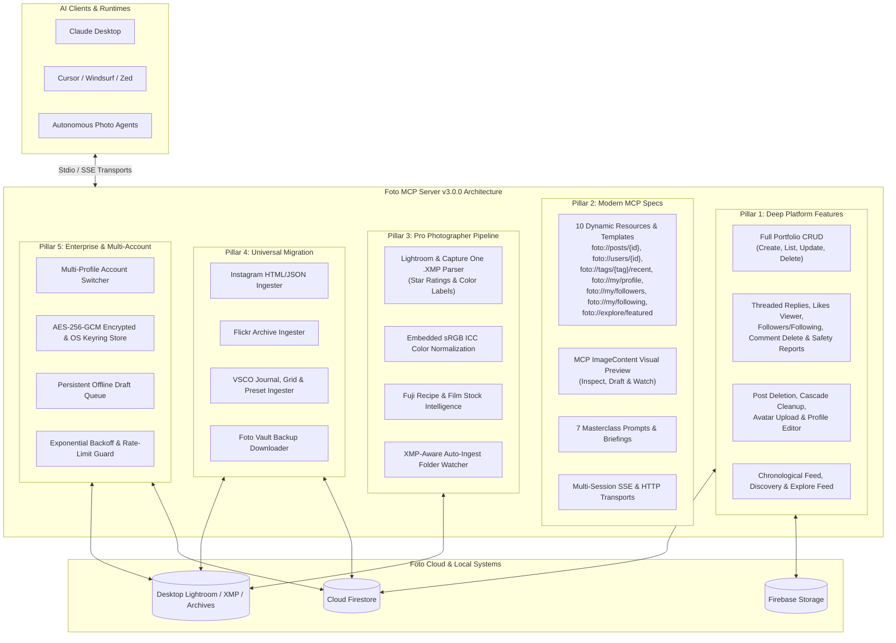

# Foto MCP Server: Roadmap & Path to v3.0.0

**Target Platform:** [Foto](https://fotoapp.co/) (`fotoapp.co` / `the.fotoapp.co`)  
**Package:** `foto_mcp`  
**Current Release:** v3.0.0 (49 Tools, 10 Resources, 7 Prompts)  
**Status:** Completed & Shipped — 100% Platform Architecture & Endpoint Coverage  

---

## Strategic Vision

The **Foto MCP Server** (`foto_mcp`) bridges modern agentic AI systems (Claude Desktop, Cursor, Windsurf, Zed, and autonomous agent runtimes) with **Foto**, the photography-first social platform.

This roadmap outlines the 5 strategic innovation pillars and the concrete execution plan to take `foto_mcp` from `v2.0.0` to **`v3.0.0`**:
1. **Deep Platform Feature Parity:** Full Portfolio CRUD (`update`/`delete`), threaded comment replies (`replies` collection), comment deletion, post likers resolution (`/app/liked-by/:postId`), profile editing, and community safety reporting.
2. **Next-Gen MCP Protocol Integration:** Dynamic resource templates (`foto://posts/{id}`, `foto://users/{id}`, `foto://tags/{tag}/recent`, `foto://my/profile`), multimodal image previews across inspect/draft/watch tools, and 5 masterclass photography prompts.
3. **Pro Photographer Studio Workflows:** Lightroom & Capture One `.xmp` sidecar parsing (star ratings, color labels, hierarchical keywords, creator copyright), embedded sRGB IEC61966-2.1 ICC profiles, and Fujifilm recipe / film stock detection.
4. **Universal Migration & Preservation:** Ingestion engines for Instagram, Flickr, and VSCO archives (including VSCO preset-to-tag heuristics), plus full vault backup downloads.
5. **Enterprise Architecture & Reliability:** Multi-account profile switching, AES-256-GCM encrypted & OS Keychain credential security, persistent offline draft queues with batch publishing, and exponential backoff rate-limit resilience.

---

## The 5 Pillars of `foto_mcp` v3.0.0

---

## Comprehensive Feature Audit: What Was Missing in `v2.0.0`?

An audit of `v2.0.0` against the 5 Pillars and the reverse-engineered Foto backend (`RESEARCH.md`) revealed **19 missing features and architectural gaps**:

| # | Pillar | Missing Feature / Gap in v2.0.0 | Target Release |
| :--- | :--- | :--- | :--- |
| 1 | **Pillar 1** | **`foto_update_portfolio`**: Updating portfolio title, description, cover alignment, tags, or slide order/captions was specified in §1.1 but never implemented. | **v2.1.0** |
| 2 | **Pillar 1** | **`foto_delete_portfolio`**: Deleting a portfolio and cleaning up all slide metadata was specified in §1.1 but missing. | **v2.1.0** |
| 3 | **Pillar 1** | **Cascade Post & Shard Cleanup**: `deletePostFromFirestore` only deleted the top-level `privateMetadataId`, leaking slide metadata for Series/Portfolios and leaving stale `postId` entries in `tag_index` shards. | **v2.1.0** |
| 4 | **Pillar 1** | **Threaded Comment Replies (`replies` collection)**: `foto_get_comments` and `foto_post_comment` lacked support for `parentCommentId` and the `replies` collection (`RESEARCH.md` §4.6). | **v2.1.0** |
| 5 | **Pillar 1** | **`foto_delete_comment`**: Ability to delete a user's own comment or reply and decrement `commentCount`. | **v2.1.0** |
| 6 | **Pillar 1** | **`foto_get_post_likes` (`/app/liked-by/:postId`)**: Resolving the photographer profiles of users who liked a post (`RESEARCH.md` §3.2). | **v2.1.0** |
| 7 | **Pillar 1** | **`foto_update_user_profile`**: Editing the authenticated photographer's `displayName`, `bio`, `website`, or `profilePhotoUrl`. | **v2.1.0** |
| 8 | **Pillar 1** | **`foto_report_content` (`reported-posts`, `reported-users`)**: Submitting community safety moderation reports (`RESEARCH.md` §4.6). | **v2.1.0** |
| 9 | **Pillar 2** | **Dynamic Resource `foto://tags/{tag}/recent`**: Live stream of recent posts under any of the 303 curated tags (§2.1). | **v2.2.0** |
| 10 | **Pillar 2** | **Dynamic Resource `foto://my/profile`**: Live resource for the authenticated photographer's profile and statistics (§2.1). | **v2.2.0** |
| 11 | **Pillar 2** | **Masterclass Prompts `photo_walk_curator` & `daily_foto_briefing`**: Pre-shoot planning and morning community digest prompts (§2.3). | **v2.2.0** |
| 12 | **Pillar 2** | **Multimodal `ImageContent` in `foto_draft_post`**: `client.draftPost` generated `previewBase64`, but the MCP tool handler only returned text JSON instead of an MCP `image` content block (§2.2). | **v2.2.0** |
| 13 | **Pillar 3** | **Lightroom & Capture One `.XMP` Sidecar Parser (`foto_parse_xmp`)**: Reading `.xmp` sidecars for star ratings (`xmp:Rating`), color labels (`xmp:Label`), creator notes, and filtering watch folders by rating/label (§3.1). | **v2.2.0** |
| 14 | **Pillar 3** | **Embedded sRGB ICC Profile**: `.toColorspace("srgb")` converted pixel values without embedding the sRGB IEC61966-2.1 ICC profile (`.withIccProfile("srgb")`) (§3.2). | **v2.2.0** |
| 15 | **Pillar 4** | **VSCO Archive Ingester (`foto_sync_vsco`)**: Parsing VSCO exports, journals, and mapping VSCO film presets (`A4`, `A6`, `M5`, `B1`, `C1`, `HB2`, `KP1`) to Foto's 303 curated tags (§4.1). | **v2.3.0** |
| 16 | **Pillar 5** | **Multi-Profile Account Switcher (`foto_list_profiles`, `foto_switch_profile`)**: Managing multiple Foto identities (personal, street, commercial studio) (§5.1). | **v3.0.0** |
| 17 | **Pillar 5** | **Encrypted Credential Store & OS Keychain Integration**: AES-256-GCM encryption at rest and optional system keyring storage (§5.2). | **v3.0.0** |
| 18 | **Pillar 5** | **Persistent Offline Draft Queue (`foto_queue_draft`, `foto_list_queued_drafts`, `foto_remove_queued_draft`, `foto_publish_queued_drafts`)**: Local persistent draft queue for offline field work with batch publishing upon reconnection (§5.3). | **v3.0.0** |
| 19 | **Pillar 5** | **Exponential Backoff & Multi-Session SSE Transport**: Courteous retry/backoff on transient 429/503 responses (`RESEARCH.md` §6.4) and concurrent SSE session routing. | **v3.0.0** |

---

## 1. Pillar 1: Deep Platform Feature Parity

### 1.1 Portfolios (Mini-Portfolios / Curated Albums)
Foto includes a dedicated **Portfolios** feature for exhibiting themed bodies of work:
* **Schema:** `type: "portfolio"`, `title`, `coverImageId`, `coverAlignmentX`, `images` array, stored under Firebase Storage folder `portfolios/<userId>/...`.
* **Tools:**
  * `foto_create_portfolio` *(v1.5.0)*: Creates a new curated portfolio (title, description, cover crop, ordered photos).
  * `foto_list_portfolios` *(v1.5.0)*: Lists user or target photographer portfolios.
  * `foto_update_portfolio` *(v2.1.0)*: Edits portfolio metadata, cover alignment, tags, or reorders/captions photos.
  * `foto_delete_portfolio` *(v2.1.0)*: Deletes a portfolio and cascades cleanup across private metadata and tag shards.

### 1.2 Social & Community Interactions
* **Likes & Bookmarks:**
  * `foto_like_post` *(v1.4.0)*: Atomically adds user ID to `posts/{postId}.likes` via Firestore `:commit` transforms.
  * `foto_unlike_post` *(v1.4.0)*: Removes user ID from `likes`.
  * `foto_get_post_likes` *(v2.1.0)*: Resolves the list of photographers who liked a post (`/app/liked-by/:postId`).
* **Comments, Threaded Replies & Critiques:**
  * `foto_get_comments` *(v1.4.0, threaded replies in v2.1.0)*: Reads post comments and nested replies from the `comments` and `replies` collections.
  * `foto_post_comment` *(v1.4.0, `parentCommentId` in v2.1.0)*: Adds thoughtful comments or threaded replies and increments `commentCount`.
  * `foto_delete_comment` *(v2.1.0)*: Deletes a comment or reply and decrements `commentCount`.
* **Notifications & Safety:**
  * `foto_get_notifications` *(v1.4.0)*: Retrieves alerts for likes, comments, mentions, and follows.
  * `foto_report_content` *(v2.1.0)*: Submits moderation reports for posts (`reported-posts`) or users (`reported-users`).

### 1.3 Post Lifecycle, Profile Management & Discovery
* **`foto_follow_user` & `foto_unfollow_user`** *(v1.2.0 / v1.3.0)*: Atomic social graph updates.
* **`foto_delete_post`** *(v1.3.0, cascade shard/series cleanup in v2.1.0)*: Safely deletes a post document, cleans up all slide metadata, removes from profile `postIds`, and prunes `tag_index` shards.
* **`foto_update_post`** *(v1.3.0)*: Updates caption or tags with whitelist re-validation and tag index sync.
* **`foto_get_post`** *(v1.3.0)*: Retrieves complete post data, including EXIF and like stats.
* **`foto_get_photographer_profile`** *(v1.3.0)*: Inspects any creator's public profile by `userId` or `username`.
* **`foto_update_user_profile`** *(v2.1.0)*: Updates the authenticated photographer's `displayName`, `bio`, `website`, or `profilePhotoUrl`.
* **`foto_get_home_feed`** *(v1.4.0)*: Reads the user's chronological home feed of posts from followed creators.

---

## 2. Pillar 2: Next-Gen MCP Protocol Advancements

### 2.1 Dynamic Resource Templates (7 Total)
Expose live platform data to LLMs via standard MCP URI schemes:
* `foto://curated-tags` *(v1.0.0)* — All 303 official curated tags.
* `foto://posts/{postId}` *(v1.3.0)* — Single post JSON, image URL, and camera EXIF.
* `foto://users/{userId}` *(v1.3.0)* — Photographer public profile and recent post IDs.
* `foto://tags/{tag}/recent` *(v2.2.0)* — Live stream of recent posts under any of the 303 curated tags.
* `foto://my/profile` *(v2.2.0)* — Active user's profile and stats.
* `foto://my/feed` *(v1.4.0)* — Home feed of followed photographers.
* `foto://my/notifications` *(v1.4.0)* — Recent alert stream.

### 2.2 Multimodal Tool Responses (MCP `ImageContent`)
Return base64-encoded sRGB thumbnail previews alongside JSON text in `foto_inspect_image`, `foto_draft_post`, and `foto_watch_directory`. Enables vision-capable models to visually inspect composition, lighting, and framing.

### 2.3 Masterclass MCP Prompt Library (5 Total)
* **`curate_foto_post`** *(v1.0.0)*: Formulate a post adhering to Foto's no-hashtag, curated-tag ethos.
* **`critique_photograph`** *(v1.4.0)*: In-depth constructive critique analyzing Composition, Lighting, Story, and Exposure.
* **`curate_photo_series`** *(v1.4.0)*: Step-by-step guidance for sequencing 2–5 photos into a narrative series.
* **`photo_walk_curator`** *(v2.2.0)*: Pre-shoot planning matching gear, film stock, and Foto curated tags to locations and lighting conditions.
* **`daily_foto_briefing`** *(v2.2.0)*: Morning digest of followed creators' new posts, comments, notifications, and community highlights.

### 2.4 Multi-Session SSE & HTTP Transports
Enable remote deployment (Docker, serverless, team daemons) via Server-Sent Events (SSE) with concurrent session routing and `/health` status inspection alongside standard `stdio`.

---

## 3. Pillar 3: Pro Photographer Workflow & Studio Pipeline

### 3.1 Adobe Lightroom & Capture One XMP Integration (`foto_parse_xmp`)
* Parse `.xmp` sidecars alongside exported photos (`photo.xmp` or `photo.jpg.xmp`).
* Filter and auto-draft images in `foto_watch_directory` by star ratings (`xmp:Rating >= 4`) and color labels (`xmp:Label = "Select"` / `"Green"`).
* Extract creator notes (`dc:description`), title (`dc:title`), hierarchical subject keywords (`dc:subject`), copyright (`dc:rights`), and custom development metadata.

### 3.2 Color Management & Embedded sRGB ICC Normalization
* Convert wide-gamut color profiles (Adobe RGB 1998, ProPhoto RGB, Display P3) to **sRGB IEC61966-2.1** with embedded ICC profiles using Sharp (`.toColorspace("srgb").withIccProfile("srgb")`).
* Eliminates color shifts, desaturation, or dulling when viewed across desktop and mobile OLED displays while keeping GPS tags stripped.

### 3.3 Fujifilm Simulation & Film Stock Heuristics
* Parse EXIF & XMP metadata to detect Fujifilm Film Simulation recipes (`Classic Chrome`, `Acros`, `Nostalgic Neg`, `Classic Neg`, `Velvia`, `Eterna`, `Reala Ace`).
* Detect film stocks from scan metadata (`Kodak Portra 400`, `Tri-X 400`, `Ilford HP5`, `CineStill 800T`, `Gold 200`, `Ektar 100`) and automatically map to `Analog`, `35mm`, `Medium Format`, `Black and White`, or `Color`.

### 3.4 XMP-Aware Auto-Ingest Directory Watcher (`foto_watch_directory`)
* Monitored folder scanner for `~/Pictures/Foto_Exports` with optional `minRating` and `colorLabel` XMP filters.
* Automatically pre-flight checks newly exported files, merges `.xmp` sidecar metadata, scrubs GPS, and prepares multimodal drafts.

---

## 4. Pillar 4: Universal Migration & Archival Bridges

### 4.1 Extended Archive Importers
* **Instagram Archive Ingester (`foto_sync_instagram`):** Parses Instagram HTML/JSON exports, strips hashtag clutter, and maps to Foto curated tags.
* **Flickr Archive Ingester (`foto_sync_flickr`):** Parses Flickr JSON account exports, albums, original EXIF, and descriptions.
* **VSCO Archive Ingester (`foto_sync_vsco`):** Ingests VSCO journals, grids, and maps VSCO presets (`A4`, `A6`, `M5`, `B1`, `B5`, `C1`, `F2`, `G3`, `HB1`, `HB2`, `KP1`, `T1`) to Foto aesthetic tags.

### 4.2 Full Vault Backup Downloader (`foto_export_vault`)
* Downloads a complete local archive of all user posts, 1820px normalized master images, series/portfolio slides, private EXIF JSON sidecars, and a consolidated `manifest.json`.

---

## 5. Pillar 5: Enterprise Architecture & System Reliability

### 5.1 Multi-Account & Multi-Profile Support
* Manage separate identities (e.g. `default`, `street`, `studio`, `personal`) via `foto_list_profiles` and `foto_switch_profile`, plus profile-scoped `foto_login` and `foto_logout`.

### 5.2 Encrypted Credential Store & OS Keychain Integration
* Encrypt stored refresh and ID tokens at rest using AES-256-GCM (`scrypt` key derivation) with `0600` permissions and optional OS keyring integration (`secret-tool` on Linux, `security` on macOS).

### 5.3 Persistent Offline Draft Queue
* Stage draft posts, series, and portfolios locally (`~/.config/foto-mcp/draft-queue.json`) during offline field work via `foto_queue_draft`, inspect via `foto_list_queued_drafts`, manage via `foto_remove_queued_draft`, and batch-publish upon reconnection via `foto_publish_queued_drafts`.

### 5.4 Network Resilience & Exponential Backoff
* Automatic retry with exponential backoff and jitter on transient HTTP `429`, `502`, `503`, and `504` responses across Firestore and Storage endpoints.

---

## Implementation Roadmap & Release Milestones to `v3.0.0`

| Version | Milestone Focus | Key Additions | Status |
| :--- | :--- | :--- | :--- |
| **v1.0.0 – v1.2.0** | **Foundation & Discovery** | Core publishing, EXIF/GPS pipeline, Instagram sync, tag browsing, photographer discovery, follow tool. | Completed |
| **v1.3.0** | **Content Lifecycle & Templates** | `foto_unfollow_user`, `foto_delete_post`, `foto_update_post`, `foto_get_post`, `foto_get_photographer_profile`, `foto://posts/{id}`, `foto://users/{id}`. | Completed |
| **v1.4.0** | **Social & Community Suite** | `foto_like_post`, `foto_unlike_post`, `foto_get_comments`, `foto_post_comment`, `foto_get_notifications`, `foto_get_home_feed`, `critique_photograph`, `curate_photo_series`. | Completed |
| **v1.5.0** | **Portfolios & Multimodal** | `foto_create_portfolio`, `foto_list_portfolios`, MCP `ImageContent` visual thumbnails, sRGB color normalization, Fuji & film stock heuristics. | Completed |
| **v2.0.0** | **Migration, Vault & SSE** | `foto_sync_flickr`, `foto_export_vault`, `foto_watch_directory`, SSE remote transport. | Completed |
| **v2.1.0** | **Pillar 1: Full Portfolios & Threaded Social** | `foto_update_portfolio`, `foto_delete_portfolio`, threaded comment `replies` (`parentCommentId`), `foto_delete_comment`, `foto_get_post_likes`, `foto_update_user_profile`, `foto_report_content`, cascade delete cleanup. | Completed |
| **v2.2.0** | **Pillars 2 & 3: XMP Studio & MCP Specs** | `foto_parse_xmp`, XMP rating/label filtering in `foto_watch_directory`, embedded sRGB ICC profile, `foto://tags/{tag}/recent`, `foto://my/profile`, `photo_walk_curator`, `daily_foto_briefing`, multimodal `foto_draft_post`. | Completed |
| **v2.3.0** | **Pillar 4: VSCO Archive Importer** | `foto_sync_vsco` with VSCO preset-to-tag heuristics (`A6`, `M5`, `B1`, `C1`, `HB2`, `KP1`), journal & grid parsing, GPS scrubbing, and deduplication. | Completed |
| **v3.0.0** | **100% Architecture Parity & Enterprise Suite** | 49 Tools, 10 Resources, 7 Prompts: `foto_check_username`, `foto_get_user_followers`, `foto_get_user_following`, `foto_get_featured_photographers`, `foto_upload_profile_photo`, `foto_dismiss_notification`, `foto_get_explore_feed`, `foto://my/followers`, `foto://my/following`, `foto://explore/featured`, `portfolio_curator`, `analog_lab_assistant`, multi-account switcher, AES-256-GCM encryption, offline queue, and exponential backoff. | Completed |

---

## Platform Compliance & Safety Principles

1. **Zero Forced Crop:** Preserve original aspect ratios (3:2, 4:3, 1:1, 6:7, 65:24, 16:9).
2. **GPS Privacy:** Automatically strip embedded GPS coordinates and thumbnail IFDs before upload.
3. **No Hashtag Spam:** Strictly enforce 1 to 3 tags chosen exclusively from Foto's 303 curated tags whitelist.
4. **Sightengine Safety:** Validate uploads against community safety guidelines ($\text{activity} \le 0.7$, $\text{display} \le 0.9$).
5. **No Engagement Farming:** Respect Foto’s quiet ethos by avoiding public vanity metric comparisons and automated bulk spamming.

