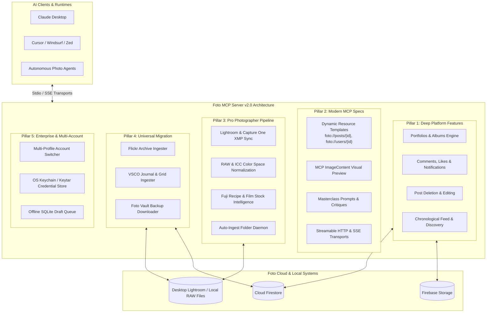

# Foto MCP Server: Roadmap & Future Functionality

**Target Platform:** [Foto](https://fotoapp.co/) (`fotoapp.co` / `the.fotoapp.co`)  
**Package:** `foto_mcp`  
**Current Release:** v1.2.0  
**Status:** Active Development & Architecture Proposal  

---

## Strategic Vision

The **Foto MCP Server** (`foto_mcp`) bridges modern agentic AI systems (Claude Desktop, Cursor, Windsurf, Zed, and autonomous agent runtimes) with **Foto**, the photography-first social platform.

This roadmap outlines 5 strategic innovation pillars designed to expand Foto MCP into an end-to-end AI companion for photographers:
1. **Deep Platform Feature Parity:** Supporting Portfolios, post editing/deletion, liking/bookmarking, comments, notifications, and home feed.
2. **Next-Gen MCP Protocol Integration:** Dynamic resource templates (`foto://posts/{id}`, `foto://users/{id}`), multimodal image previews, and masterclass critique prompts.
3. **Pro Photographer Studio Workflows:** Lightroom/Capture One XMP sidecar parsing, sRGB/ICC color management, and Fujifilm film simulation / film stock detection.
4. **Universal Migration & Preservation:** Ingestion engines for Flickr and VSCO archives, plus full vault backup downloads.
5. **Enterprise Architecture & Reliability:** Multi-account switching, OS Keychain credential security, and offline SQLite draft queues.

---

## The 5 Pillars of Improvement

---

## 1. Pillar 1: Deep Platform Feature Parity

### 1.1 Portfolios (Mini-Portfolios / Curated Albums)
Foto includes a dedicated **Portfolios** feature for exhibiting themed bodies of work:
* **Schema:** `type: "portfolio"`, `title`, `coverImageId`, `coverAlignmentX`, `images` array, stored under Firebase Storage folder `portfolios/<userId>/...`.
* **New Tools:**
  * `foto_create_portfolio`: Creates a new curated portfolio (title, description, cover crop, ordered photos).
  * `foto_list_portfolios`: Lists user or target photographer portfolios.
  * `foto_update_portfolio`: Edits portfolio metadata or reorders photos.
  * `foto_delete_portfolio`: Deletes a portfolio.

### 1.2 Social & Community Interactions
* **Likes & Bookmarks:**
  * `foto_like_post`: Atomically adds user ID to `posts/{postId}.likes` via Firestore `:commit` transforms.
  * `foto_unlike_post`: Removes user ID from `likes`.
* **Comments & Critiques:**
  * `foto_get_comments`: Reads post comments and threaded replies.
  * `foto_post_comment`: Adds thoughtful comments and increments `commentCount`.
* **Notifications:**
  * `foto_get_notifications`: Retrieves alerts for likes, comments, mentions, and follows.

### 1.3 Post Lifecycle & Discovery
* **`foto_unfollow_user`**: Expose existing client method as an MCP tool.
* **`foto_delete_post`**: Safely deletes a post document, cleans up metadata, and removes from profile `postIds`.
* **`foto_update_post`**: Updates caption or tags with whitelist re-validation and tag index sync.
* **`foto_get_post`**: Retrieves complete post data, including EXIF and like stats.
* **`foto_get_photographer_profile`**: Inspects any creator's public profile by `userId` or `username`.
* **`foto_get_home_feed`**: Reads the user's chronological home feed of posts from followed creators.

---

## 2. Pillar 2: Next-Gen MCP Protocol Advancements

### 2.1 Dynamic Resource Templates
Expose live platform data to LLMs via standard MCP URI schemes:
* `foto://posts/{postId}` — Single post JSON, image URL, and camera EXIF.
* `foto://users/{userId}` — Photographer public profile and recent post IDs.
* `foto://tags/{tag}/recent` — Live stream of recent posts under any of the 303 curated tags.
* `foto://my/profile` — Active user's profile and stats.
* `foto://my/feed` — Home feed of followed photographers.
* `foto://my/notifications` — Recent alert stream.

### 2.2 Multimodal Tool Responses (MCP `ImageContent`)
Return base64-encoded thumbnail previews alongside JSON text in `foto_inspect_image` and `foto_draft_post`. This enables vision-capable models (e.g. Claude 3.5 Sonnet) to visually inspect composition, lighting, and framing, drastically enhancing tag suggestions and aesthetic feedback.

### 2.3 Masterclass MCP Prompt Library
* **`curate_photo_series`**: Step-by-step guidance for sequencing 2–5 photos into a narrative series.
* **`critique_photograph`**: In-depth constructive critique analyzing Composition, Lighting, Story, and Exposure.
* **`photo_walk_curator`**: Pre-shoot planning matching gear, film stock, and Foto curated tags to locations.
* **`daily_foto_briefing`**: Morning digest of followed creators' new posts, comments, and community highlights.

### 2.4 Streamable HTTP & SSE Transports
Enable remote deployment (Docker, serverless, team daemons) via Server-Sent Events (SSE) and Streamable HTTP alongside standard `stdio`.

---

## 3. Pillar 3: Pro Photographer Workflow & Studio Pipeline

### 3.1 Adobe Lightroom & Capture One XMP Integration
* Parse `.xmp` sidecars alongside exported photos.
* Filter and auto-draft images by star ratings (`xmp:Rating = 5`) and color labels (`xmp:Label = "Select"`).
* Extract creator notes, copyright, and custom development metadata.

### 3.2 Color Management & sRGB Normalization
* Explicitly convert wide-gamut color profiles (Adobe RGB 1998, ProPhoto RGB, Display P3) to **sRGB IEC61966-2.1** with embedded ICC profiles using Sharp.
* Eliminates color shifts, desaturation, or dulling when viewed across desktop and mobile OLED displays.

### 3.3 Fujifilm Simulation & Film Stock Heuristics
* Parse EXIF MakerNotes to detect Fujifilm Film Simulation recipes (`Classic Chrome`, `Acros`, `Nostalgic Neg`).
* Detect film stocks from scan metadata (`Kodak Portra 400`, `Tri-X 400`, `Ilford HP5`, `CineStill 800T`) and automatically map to `Analog`, `35mm`, `Medium Format`, `Black and White`, or `Color`.

### 3.4 Auto-Ingest Directory Watcher (`foto_watch_folder`)
* Monitored folder daemon for `~/Pictures/Foto_Exports`.
* Automatically pre-flight checks newly exported files, scrubs GPS, checks duplicates, and prepares drafts for chat review.

---

## 4. Pillar 4: Universal Migration & Archival Bridges

### 4.1 Extended Archive Importers
* **Flickr Archive Ingester (`foto_sync_flickr`):** Parses Flickr JSON account exports, albums, original EXIF, and descriptions.
* **VSCO Archive Ingester (`foto_sync_vsco`):** Ingests VSCO journals, grids, and maps VSCO presets (`A6`, `M5`, `B1`) to Foto aesthetic tags.

### 4.2 Full Vault Backup Downloader (`foto_export_vault`)
* Downloads a complete local archive of all user posts, 1820px normalized master images, private EXIF JSON documents, and a consolidated `manifest.json`.

---

## 5. Pillar 5: Enterprise Architecture & System Reliability

### 5.1 Multi-Account & Multi-Profile Support
* Manage separate identities (e.g. personal, street photography, commercial portrait studio) via `foto_switch_profile` and `foto_list_profiles`.

### 5.2 Secure OS Keychain Integration
* Optional credential storage in system keyrings (macOS Keychain, Windows Credential Manager, Linux Secret Service).

### 5.3 Offline SQLite Draft Queue
* Store draft posts locally in an embedded SQLite database for offline field work, with one-click batch publishing upon reconnection.

---

## Implementation Roadmap & Release Milestones

| Version | Milestone Focus | Key Additions |
| :--- | :--- | :--- |
| **v1.3.0** | **Platform Parity & Content Lifecycle** | `foto_unfollow_user`, `foto_delete_post`, `foto_update_post`, `foto_get_post`, `foto_get_photographer_profile`, dynamic resource templates (`foto://posts/{id}`, `foto://users/{id}`). |
| **v1.4.0** | **Social & Community Interaction** | `foto_like_post`, `foto_unlike_post`, `foto_get_comments`, `foto_post_comment`, `foto_get_notifications`, `foto_get_home_feed`, `critique_photograph` & `curate_photo_series` prompts. |
| **v1.5.0** | **Portfolios & Visual Multimodal** | `foto_create_portfolio`, `foto_list_portfolios`, MCP `ImageContent` visual thumbnails, sRGB/ICC color normalization, Fuji recipe & film stock classification heuristics. |
| **v2.0.0** | **Pro Studio & Universal Migration** | Flickr & VSCO archive importers, `foto_export_vault` archive downloader, folder watching daemon, Streamable HTTP / SSE remote transports. |

---

## Platform Compliance & Safety Principles

1. **Zero Forced Crop:** Preserve original aspect ratios (3:2, 4:3, 1:1, 6:7, 65:24, 16:9).
2. **GPS Privacy:** Automatically strip embedded GPS coordinates and thumbnail IFDs before upload.
3. **No Hashtag Spam:** Strictly enforce 1 to 3 tags chosen exclusively from Foto's 303 curated tags whitelist.
4. **Sightengine Safety:** Validate uploads against community safety guidelines ($activity \le 0.7$, $display \le 0.9$).
5. **No Engagement Farming:** Respect Foto’s quiet ethos by avoiding public vanity metric comparisons and automated bulk spamming.
